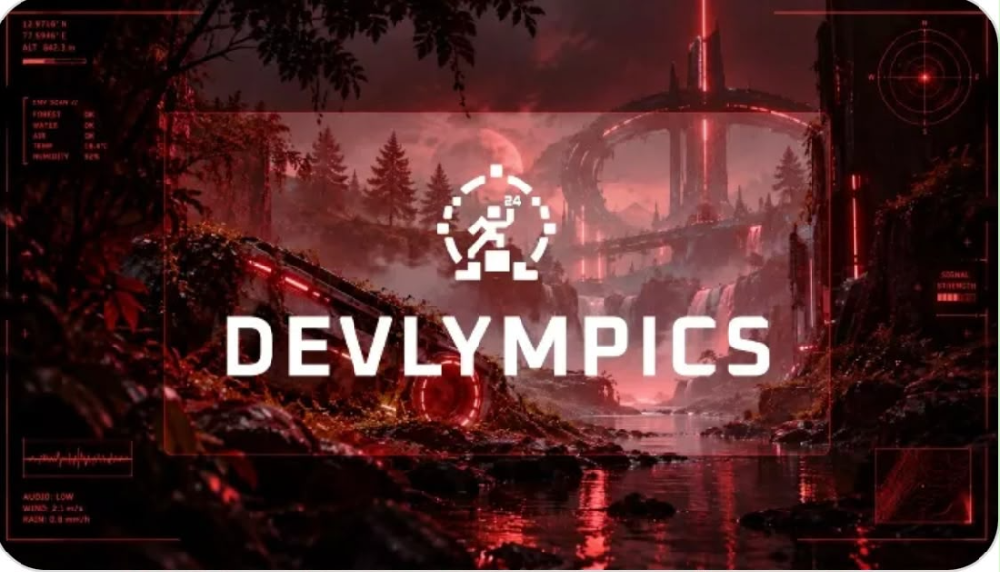

<div align="center">

# 👁️ AuraVision: Edge AI Multimodal Assistive Vision Platform

[](https://www.python.org/downloads/)
[](https://flask.palletsprojects.com/)
[](https://opencv.org/)
[](https://github.com/ultralytics/ultralytics)
[](https://mistral.ai/)
[](https://unstop.com/o/FzqN56l?lb=KzCLvTxO&utm_medium=Share&utm_source=WhatsApp)

<br/>



### *Empowering visually impaired individuals with low-latency edge intelligence, spatial perception, and tactile emergency response.*

[🏆 View on Unstop (Devlympics 2026)](https://unstop.com/o/FzqN56l?lb=KzCLvTxO&utm_medium=Share&utm_source=WhatsApp) • [💻 Live Demo](#quickstart) • [📐 System Architecture](#system-architecture) • [⚡ Hardware Setup](#hardware-specifications)

</div>

---

## 📌 Executive Summary

**AuraVision** is an edge-native, hands-free wearable assistive platform engineered for the **NSUT Devlympics 2026** competition at Netaji Subhas University of Technology (NSUT), Dwarka.

Built with a hybrid edge-compute pipeline, AuraVision bridges ultra-lightweight optical sensors (Raspberry Pi Zero W / ESP32-CAM) with localized deep learning inference engines to deliver sub-50ms perceptual awareness, real-time spatial object detection, OCR reading, automated UPI payment parsing, and a high-priority distress SOS beacon.

---

## ✨ Key Features & Capabilities

| Module | Engine / Driver | Description |
| :--- | :--- | :--- |
| 🎯 **Spatial Object Detection** | YOLOv8 + OpenCV | Real-time object tracking, obstacle distance estimation, and tactile auditory alerts. |
| 📖 **Document Reading (OCR)** | EasyOCR + Edge-TTS | High-precision textual parsing for signage, printed books, medicine labels, and forms. |
| 💳 **Instant Payment Parser** | Dynamic QR Core | Real-time extraction of UPI payee details, transaction verification, and acoustic readout. |
| 🤖 **Conversational AI Companion**| Mistral LLM + VAD | Continuous speech interaction with barge-in support and domain reasoning. |
| 🚨 **Distress SOS Beacon** | Automated Telemetry | 1-click & voice-activated emergency protocol with visual strobe alert and evidence capture. |
| 📹 **Dual Sensor Failover** | Auto-Detect Driver | Seamless wireless streaming from wearable hardware camera with local optical sensor failover. |

---

## 📐 System Architecture

```mermaid
flowchart TD
    subgraph Hardware [" Wearable Vision Node (Raspberry Pi Zero W) "]
        A[5MP Optical Sensor / V4L2] --> B[VideoCore IV Hardware Encoder]
        B --> C[MJPEG Streamer :8080]
        D[Tactile Mode Buttons] --> E[GPIO Interrupt Daemon]
    end

    subgraph EdgeNode [" Edge Processing Unit (Laptop / Host) "]
        C -. WiFi 2.4GHz .-> F[Dual Failover Video Capture Engine]
        E -. State Polling .-> G[Mode & Telemetry Dispatcher]
        
        F --> H{Active Pipeline}
        H -->|Mode 1| I[YOLOv8 Detection Core]
        H -->|Mode 2| J[EasyOCR Document Reader]
        H -->|Mode 3| K[UPI Payment QR Parser]
        H -->|Mode 4| L[Mistral LLM Speech Companion]
        H -->|SOS Mode| M[Distress Beacon & Auto-Snapshot]
        
        I & J & K & L & M --> N[Cybernetic HUD & Flask Server :8081]
    end

    subgraph Client [" User Interface "]
        N --> O[Web Control Dashboard /dashboard]
        N --> P[Binaural Audio Synthesizer]
    end
```

---

## 🚀 Quickstart & Installation

### 1. Clone the Repository
```bash
git clone https://github.com/your-username/AuraVision.git
cd AuraVision
```

### 2. Environment Setup
Create a virtual environment with Python 3.10+:
```bash
python -m venv venv

# Windows
venv\Scripts\activate

# Linux / macOS
source venv/bin/activate
```

Install core dependencies:
```bash
pip install -r requirements.txt
```

### 3. Configure Credentials
Copy the example environment template:
```bash
cp .env.example .env
```
Edit `.env` to configure your API tokens (e.g., Mistral API key for conversational AI mode):
```ini
MISTRAL_API_KEY=your_key_here
PI_STREAM_URL=http://172.20.10.3:8080/
CAMERA_PREFERENCE=laptop
```

### 4. Launch the System

#### **Windows:**
Double-click `run.bat` or run:
```cmd
python auravision.py
```

#### **Linux / macOS:**
```bash
chmod +x run.sh
./run.sh
```

Open your browser and navigate to:
- **Cybernetic Operations Dashboard:** [http://localhost:8081/dashboard](http://localhost:8081/dashboard)
- **Live Stream Endpoint:** [http://localhost:8081/video_feed](http://localhost:8081/video_feed)
- **Telemetry Health Check:** [http://localhost:8081/status](http://localhost:8081/status)

---

## 🔌 Hardware Specifications & Pinout

For the wearable IoT vision unit running `pi_server.py`:

| Component | Pin (BCM) | Physical Header Pin | Function |
| :--- | :--- | :--- | :--- |
| **Object Detection** | GPIO 17 | Pin 11 | Mode 1: Spatial Detection |
| **Document Reader** | GPIO 27 | Pin 13 | Mode 2: OCR Reading |
| **Payment Mode** | GPIO 22 | Pin 15 | Mode 3: Payment Verification |
| **AI Assistant** | GPIO 23 | Pin 16 | Mode 4: Conversational AI |
| **SOS Emergency** | GPIO 24 | Pin 18 | Emergency Beacon Trigger |
| **Ground Reference**| GND | Pin 6 / Pin 14 | Button Common Return |

Run on Raspberry Pi:
```bash
python3 pi_server.py
```

---

## 🛡️ Competition & Event Details
- **Hackathon:** Devlympics 2026
- **Organizer:** Netaji Subhas University of Technology (NSUT), Dwarka, New Delhi
- **Official Portal:** [Unstop Devlympics 2026 Competition](https://unstop.com/o/FzqN56l?lb=KzCLvTxO&utm_medium=Share&utm_source=WhatsApp)

---

## 📄 License
Distributed under the **MIT License**. See `LICENSE` for more information.
